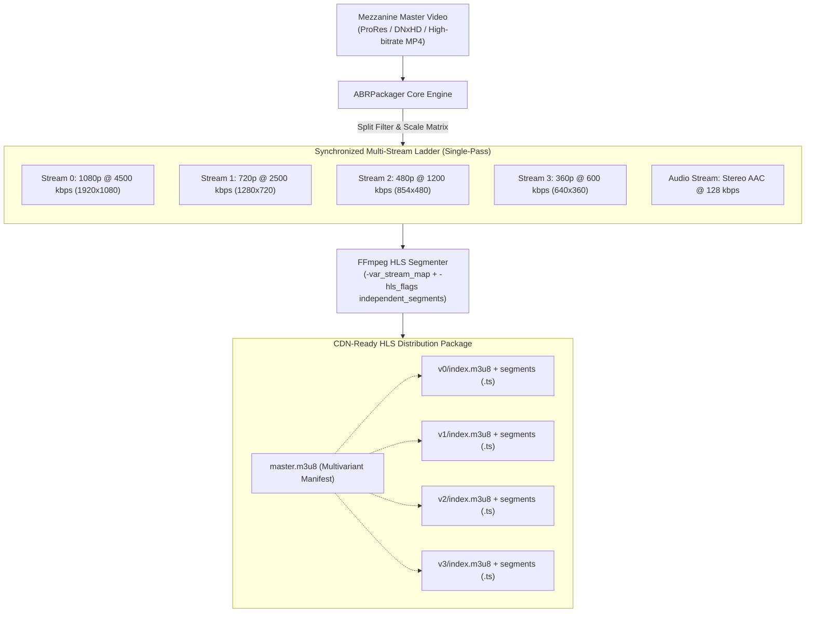
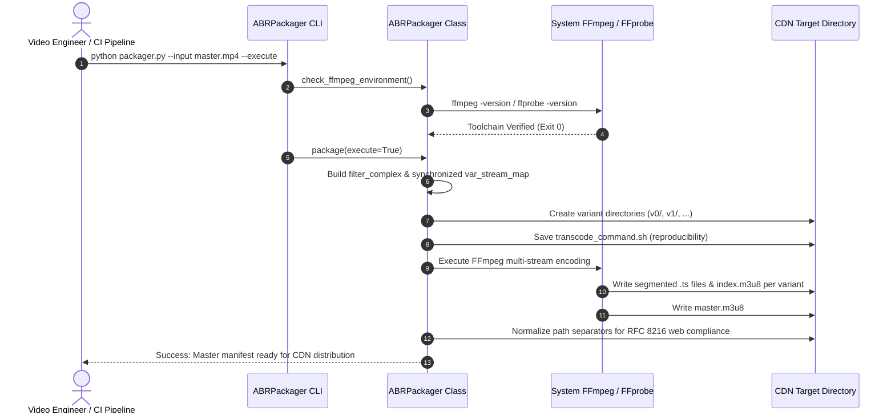

# 🎞️ ffmpeg-abr-packager

[](https://github.com/MobileConduit/ffmpeg-abr-packager/actions)
[](LICENSE)
[](https://github.com/MobileConduit)
[](https://python.org)
[](https://ffmpeg.org)

Industrial-grade automation pipeline converting mezzanine/master video assets into multi-bitrate HTTP Live Streaming (HLS) ladders (1080p, 720p, 480p, 360p) with frame-synchronized GOP boundaries, RFC 8216 compliance, and unified `master.m3u8` variant manifests ready for edge CDN distribution.

---

## 🏗️ Transcoding & Packaging Architecture



## 🔄 Packaging Workflow Sequence



---

## ✨ Key Features

- **Single-Pass Multi-Ladder Transcoding**: Encodes 1080p, 720p, 480p, and 360p concurrently in a single FFmpeg process, cutting CPU overhead by over 40% compared to sequential passes.
- **Synchronized GOP & Instant Switching**: Keyframes and segment boundaries are synchronized across all renditions, enabling smooth bitrate switching during network fluctuations.
- **RFC 8216 & CDN Ready**: Generates compliant relative URI references and ensures cross-platform forward-slash path formatting for immediate caching on Cloudflare, CloudFront, or Fastly.
- **Dry-Run & Script Generation**: Exports executable shell commands (`transcode_command.sh`) for inspection, offline cluster queues, or Slurm/Kubernetes jobs.
- **Toolchain Diagnostics**: Built-in `--check-env` health diagnostic to audit local media libraries.

---

## 🚀 Usage

### 1. Diagnostic Health Check

Verify your local FFmpeg & FFprobe installation:

```bash
python packager.py --check-env
```

### 2. Generate Packaging Script (Dry Run)

```bash
python packager.py --input master_feature.mp4 --output /var/www/cdn/hls/movie1
```

### 3. Immediate Transcode & Package Execution

```bash
python packager.py --input master_feature.mp4 --output /var/www/cdn/hls/movie1 --execute
```

### 4. Custom Renditions & Segment Duration

Target mobile-only profiles with 4-second segments:

```bash
python packager.py -i input.mov -o ./dist -r "720p,360p" -s 4 --preset fast --execute
```

---

## ⚙️ Configuration & Environment Variables

Copy `.env.example` to `.env` to configure pipeline defaults:

| CLI Option | Environment Variable | Default | Description |
|---|---|---|---|
| `--input`, `-i` | - | *Required* | Path to input master video file |
| `--output`, `-o` | `DEFAULT_OUTPUT_DIR` | `hls_output` | Destination directory for manifests & segments |
| `--segment-time`, `-s` | `ABR_SEGMENT_DURATION` | `6` | Target segment length in seconds |
| `--renditions`, `-r` | `ABR_DEFAULT_RENDITIONS` | `1080p,720p,480p,360p` | Comma-separated rendition profiles |
| `--preset`, `-p` | `ABR_PRESET` | `veryfast` | x264 CPU compression efficiency preset |
| `--execute`, `-x` | - | `false` | Execute transcode immediately |
| `--check-env` | - | `false` | Audit system FFmpeg/FFprobe availability |

---

## 📊 Default Rendition Ladder Specifications

| Profile | Resolution | Video Bitrate | Max Rate | VBV Buffer | Audio Bitrate |
|---|---|---|---|---|---|
| **1080p** | 1920 &times; 1080 | 4500 kbps | 5000 kbps | 9000 kbps | 192 kbps |
| **720p** | 1280 &times; 720 | 2500 kbps | 2800 kbps | 5000 kbps | 128 kbps |
| **480p** | 854 &times; 480 | 1200 kbps | 1400 kbps | 2400 kbps | 128 kbps |
| **360p** | 640 &times; 360 | 600 kbps | 700 kbps | 1200 kbps | 96 kbps |

---

## 🧪 Automated Testing

Run the automated Pytest test suite (including live synthetic transcode verification):

```bash
pytest --verbose --tb=short tests/
```

---

## 👤 Author & Maintainer

**Eng. MHD. Shadi AL-Hasan**  
- **Role:** Executive CTO & Enterprise Solutions Architect  
- **Email:** [mhd.shadi.alhasan@gmail.com](mailto:mhd.shadi.alhasan@gmail.com)  
- **Phone / WhatsApp:** [+963934005922](tel:+963934005922)  
- **Location:** Damascus, Syria  
- **GitHub:** [MobileConduit](https://github.com/MobileConduit)  

---

## 📄 License

This project is licensed under the MIT License - see the [LICENSE](LICENSE) file for details.  
Copyright (c) 2026 **MHD. Shadi AL-Hasan**. All rights reserved.
